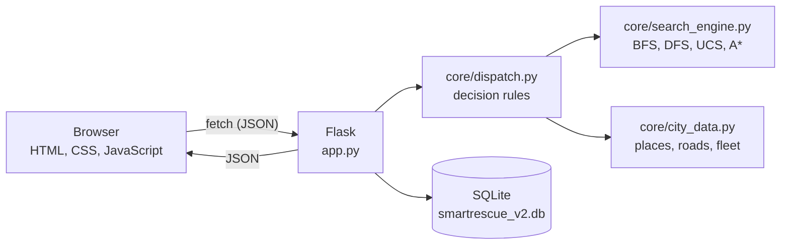
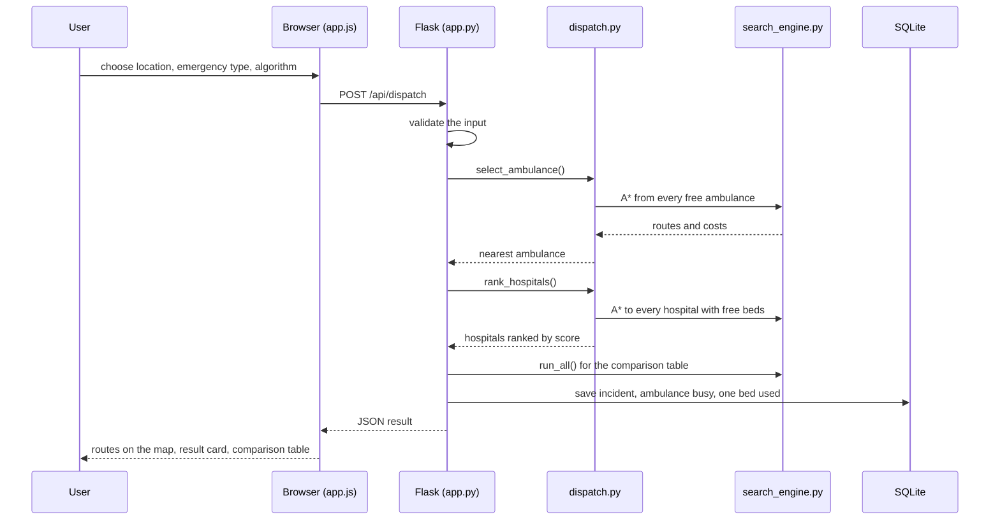

# 🚑 SmartRescue AI

**An emergency response simulator that decides which ambulance to send, which hospital to go to, and which route to take, using classic AI search algorithms.**


>  **This is an educational simulation.** It uses sample data and approximate coordinates. It is **not** a real dispatch system and must not be used for real emergencies.

---

## 📑 Table of contents

1. [Overview](#-overview)
2. [Features](#-features)
3. [Screenshots](#-screenshots)
4. [How it works](#-how-it-works)
5. [The AI explained](#-the-ai-explained)
6. [Dispatch decision rules](#-dispatch-decision-rules)
7. [Project structure](#-project-structure)
8. [Tech stack](#-tech-stack)
9. [API reference](#-api-reference)
10. [Database design](#-database-design)
11. [Getting started](#-getting-started)
12. [Using the website](#-using-the-website)
13. [Running the tests](#-running-the-tests)
14. [Customising the project](#-customising-the-project)
15. [Limitations](#-limitations)
16. [Future improvements](#-future-improvements)
17. [What I learned](#-what-i-learned)
18. [Author](#-author)

---

## Overview

When an emergency happens, a control room has to answer three questions quickly:

1. **Which ambulance** should go? (the nearest free one)
2. **Which hospital** should receive the patient? (close, has free beds, has the right specialty)
3. **Which road path** is best? (the lowest cost, avoiding closed roads)

SmartRescue AI answers all three. It models a part of Islamabad as a **graph**: places are nodes and roads are edges. It then uses **search algorithms (BFS, DFS, UCS and A\*)** to find routes, and shows the result on a live map.

The project also lets you **compare the four algorithms on the same problem**, so you can see for yourself why A\* is the best choice for this job.

---

##  Features

| Area | What you get |
|---|---|
| **AI routing** | BFS, DFS, UCS and A\* implemented from scratch, compared by route cost, number of roads, nodes visited and run time |
| **Smart dispatch** | Picks the nearest *available* ambulance and ranks hospitals by distance, free beds and specialty match |
| **Road closures** | Click a road on the map to block or reopen it. Every algorithm automatically avoids closed roads |
| **Live dashboard** | Cards for total emergencies, ambulances available, free beds and blocked roads, plus charts. Auto-refreshes every 5 seconds |
| **Algorithm Lab** | Animated, step-by-step replay of how each algorithm explores the map |
| **Saved data** | Every emergency is stored with its full result. Ambulance status, hospital beds and road closures are also saved, so everything survives a restart |
| **Incident records** | Search, filter, resolve, and export the history to CSV |
| **Resource management** | Take ambulances offline or online, discharge patients to free beds, reopen roads, reset the simulation |
| **Light and dark theme** | The choice is remembered by the browser |
| **Tested** | 19 automated tests for the AI logic and the web API |

##  How it works

### The big picture

Think of a restaurant:

| Restaurant | This project |
|---|---|
| Customer with a menu | **Browser** (`index.html`, `style.css`, `app.js`) |
| Waiter | **Flask** (`app.py`). Takes the order and brings the answer |
| Kitchen | **`core/` folder**. The real thinking (AI and rules) |
| Storeroom | **SQLite database**. Remembers everything |

The browser never talks to the AI code or the database directly. It only sends requests to Flask, and Flask uses the `core` modules.



### What happens when the server starts

1. `build_graph()` creates the city map in memory (15 places, 25 roads).
2. `database.init_db()` creates the tables if they do not exist. On the very first run it also inserts the 5 ambulances and 4 hospitals.
3. Road closures saved earlier are loaded back into the graph.
4. Flask starts a web server at `http://127.0.0.1:5000`.

### What happens when you open the website

1. The browser asks for `/` and receives `index.html`, then loads the CSS and JavaScript.
2. `app.js` calls `refresh()`, which requests the network, the summary and the recent incidents **at the same time**.
3. The map, cards, charts and tables are drawn from that data.
4. A timer repeats this every 5 seconds, so the page stays up to date.

### What happens when you click "Dispatch ambulance"



**Worked example:** Faizabad, Cardiac Arrest, A\*

1. **Ambulance 05** (at I-8 Markaz) is the cheapest. Route cost is 1.4 along `I-8 → Faizabad`.
2. **Shifa International** wins the hospital ranking because it is close and has a cardiac specialty. Route cost is 5.61 along `Faizabad → I-8 → Shifa`.
3. Total cost is 1.4 + 5.61 = **7.01**.
4. The incident is saved, Ambulance 05 becomes busy, and Shifa loses one free bed.

### Other actions

- **Resolve:** marks the incident as resolved. The ambulance becomes available again at the hospital's location.
- **Block a road:** the road is saved in the database. Because `Graph.neighbors()` skips blocked roads, all four algorithms avoid it without any extra code.
- **Reset:** puts ambulances, beds and roads back to their starting values.

---

##  The AI explained

### 1. The city is a graph

- **Nodes** are places (for example F-6 Markaz, Zero Point, PIMS).
- **Edges** are roads between places.
- Each edge has a **cost**:

```
cost = straight-line distance (km) × 1.3 × traffic multiplier
```

The 1.3 accounts for real roads being longer than a straight line. The traffic multiplier is 1.0 or more (a larger number means heavier traffic).

### 2. The four algorithms

| Algorithm | Idea | Data structure | Finds the cheapest path? |
|---|---|---|---|
| **BFS** | Explore level by level | Queue |  Only the path with the fewest roads |
| **DFS** | Go as deep as possible first | Stack | Any path, often a poor one |
| **UCS** | Always expand the cheapest path so far | Priority queue | Yes |
| **A\*** | UCS plus an estimate of the remaining distance | Priority queue |  Yes, and explores fewer places |

**How A\* decides what to explore next**

```
f(n) = g(n) + h(n)
```

- `g(n)` is the real cost from the start to place `n`.
- `h(n)` is the **heuristic**: the straight-line distance from `n` to the goal.
- A\* always expands the place with the smallest `f`, so it moves toward the goal instead of spreading in every direction.
- UCS is the same algorithm with `h(n) = 0`.

### 3. Why A\* is guaranteed to be optimal

A\* is optimal when the heuristic is **admissible**, meaning it never overestimates the real remaining cost. Here, every road cost is `straight-line × 1.3 × traffic` with traffic ≥ 1, so the real cost is **never smaller** than the straight-line distance. Our heuristic therefore never overestimates, and A\* always returns the cheapest path.

### 4. Sample comparison (from the default data)

Cost of the ambulance route in two scenarios:

| Scenario | BFS | DFS | UCS | A\* |
|---|---|---|---|---|
| Ambulance from Zero Point to G-10 Markaz | cost 13.88 | cost 15.33 | cost **8.49** | cost **8.49** |
| Nodes visited (same scenario) | 14 | 11 | 13 | **4** |
| Ambulance from I-8 Markaz to Shifa area | cost 4.21 | cost **28.49** | cost 4.21 | cost 4.21 |

What this shows: BFS minimises the number of roads, not the cost. DFS can return a very expensive path. UCS and A\* always find the cheapest path, and A\* gets there by visiting far fewer places.

---

##  Dispatch decision rules

**Choosing the ambulance** (`select_ambulance`)

- Skip ambulances that are busy.
- Run A\* from each free ambulance to the incident.
- Choose the one with the lowest route cost.
- If no ambulance can reach the place (for example because roads are blocked), return an error instead of guessing.

**Ranking the hospitals** (`rank_hospitals`)

- Skip hospitals with no free beds.
- Run A\* from the incident to each remaining hospital.
- Give each hospital a score (**lower is better**):

```
score = route cost
        + 5   if the hospital has 2 or fewer free beds   (nearly full)
        − 3   if the hospital matches the emergency's specialty
```

The five emergency types map to specialties: Cardiac Arrest → cardiac, Road Accident → trauma, Burn / Fire Injury → burns, Maternity Emergency → maternity, General Medical → general.

The constants `LOW_BED_LIMIT`, `LOW_BED_PENALTY` and `SPECIALTY_BONUS` are at the top of `core/dispatch.py`, so the rules are easy to change.

---

## 📁 Project structure

```
SmartRescueAI/
├── app.py                  # Flask routes (the API). The ONLY file you run
├── requirements.txt        # Python packages (Flask)
├── README.md
├── core/
│   ├── __init__.py         # empty file that makes "core" a package
│   ├── search_engine.py    # Graph class + BFS, DFS, UCS, A*   (the AI part)
│   ├── city_data.py        # places, roads, ambulances, hospitals (simulated data)
│   ├── dispatch.py         # ambulance selection + hospital ranking
│   └── database.py         # SQLite: incidents, fleet, beds, road closures
├── templates/
│   └── index.html          # website layout (5 pages)
├── static/
│   ├── css/style.css       # theme (light and dark)
│   └── js/app.js           # navigation, live refresh, maps, charts, lab
└── tests/
    ├── test_core.py        # tests for the AI and dispatch rules
    └── test_app.py         # tests for the web API and saved data
```

**Design principle:** `app.py` contains only web routes. All the real logic lives in `core/`, so the AI code can be tested on its own without starting a web server.

---

## Tech stack

| Layer | Technology |
|---|---|
| Language | Python 3 |
| Web framework | Flask |
| Database | SQLite (built into Python, nothing to install) |
| Front end | HTML, CSS, vanilla JavaScript |
| Map | [Leaflet](https://leafletjs.com/) with OpenStreetMap tiles |
| Charts | [Chart.js](https://www.chartjs.org/) |
| Testing | `unittest` (built into Python) |

---

##  API reference

All responses are JSON unless noted. Errors return `{"error": "message"}` with status **400** (bad input), **404** (not found) or **409** (conflict, for example no ambulance available).

| Method | Endpoint | Description |
|---|---|---|
| GET | `/` | The website |
| GET | `/api/network` | Places, roads (with blocked flag), ambulances, hospitals, emergency types, algorithms |
| GET | `/api/summary` | Dashboard numbers: totals, available ambulances, free beds, blocked roads |
| GET | `/api/incidents` | Incident history. Optional query: `status`, `q` (search text), `limit` |
| GET | `/api/export.csv` | Download the history as a CSV file |
| POST | `/api/dispatch` | Dispatch an ambulance (see below) |
| POST | `/api/incidents/<id>/resolve` | Resolve an active incident |
| POST | `/api/roads/toggle` | Block or reopen a road. Body: `{"a": "FM", "b": "F7"}` |
| POST | `/api/ambulances/<id>/toggle` | Take an ambulance offline or bring it online |
| POST | `/api/hospitals/<id>/discharge` | Free one hospital bed |
| POST | `/api/lab` | Run all four algorithms between two places. Body: `{"start": "DK", "end": "FZ"}` |
| POST | `/api/reset` | Reset ambulances, beds and roads. Body: `{"clear_history": true}` also deletes the history |

**Example: dispatch**

Request:

```json
POST /api/dispatch
{ "location": "FZ", "emergency_type": "Cardiac Arrest", "algorithm": "A*" }
```

Response (shortened):

```json
{
  "incident_id": 1,
  "incident": { "node": "FZ", "name": "Faizabad", "type": "Cardiac Arrest" },
  "ambulance": { "id": "A5", "name": "Ambulance 05", "node": "I8", "available": true },
  "hospital": { "id": "H3", "name": "Shifa International", "node": "SHIFA" },
  "algorithm": "A*",
  "route_to_incident": { "path": ["I8", "FZ"], "cost": 1.4, "hops": 1, "visited": 2 },
  "route_to_hospital": { "path": ["FZ", "I8", "SHIFA"], "cost": 5.61, "hops": 2, "visited": 3 },
  "total_cost": 7.01,
  "hospital_ranking": [ { "name": "Shifa International", "score": 2.61 } ],
  "comparison": [ { "algorithm": "BFS" }, { "algorithm": "DFS" }, { "algorithm": "UCS" }, { "algorithm": "A*" } ]
}
```

---

## 🗄 Database design

SQLite file: `smartrescue_v2.db` (created automatically on the first run).

| Table | Columns | Purpose |
|---|---|---|
| `incidents` | id, created_at, resolved_at, status, emergency_type, location, algorithm, ambulance_id, ambulance, hospital_id, hospital, total_cost, payload_json | Every emergency. `payload_json` stores the full result so a route can be shown again later |
| `ambulances` | id, name, node, available | Current location and availability of each ambulance |
| `hospitals` | id, name, node, beds, capacity, specialties | Free beds and specialties |
| `blocked_roads` | a, b | Closed roads |

Safety notes: all SQL uses `?` placeholders (protects against SQL injection), and bed counts are clamped between 0 and the hospital's capacity.

---

## 🚀 Getting started

### Prerequisites

- **Python 3.9 or newer** (developed and tested with Python 3.12)
- An **internet connection** (the map tiles, Leaflet, Chart.js and the font load from the web)

### Installation

```bash
# 1. Get the code
git clone https://github.com/<your-username>/SmartRescueAI.git
cd SmartRescueAI

# 2. (Recommended) create a virtual environment
python -m venv venv
venv\Scripts\activate          # Windows
# source venv/bin/activate     # macOS / Linux

# 3. Install the only dependency
pip install -r requirements.txt

# 4. Run
python app.py
```

Then open **http://127.0.0.1:5000** in your browser. Press `Ctrl + C` in the terminal to stop the server.

> **VS Code users:** open the whole `SmartRescueAI` folder (File → Open Folder), then run `app.py`. If you open only the single file, Python cannot find the `core` folder.

### Troubleshooting

| Problem | Fix |
|---|---|
| `ModuleNotFoundError: No module named 'flask'` | Run `pip install flask` |
| `python is not recognized` | Try `py app.py` (Windows) or `python3 app.py` |
| PowerShell blocks `activate` | Run `Set-ExecutionPolicy -Scope Process RemoteSigned` first |
| Port 5000 already in use | Change the last line of `app.py` to `app.run(debug=True, port=5001)` |
| The map is blank | Check your internet connection (map tiles load from the web) |
| Want to start from scratch | Click **Reset** on the Resources page, or delete `smartrescue_v2.db` |

---

## 🖥 Using the website

| Page | What to do there |
|---|---|
| **Dashboard** | See live numbers, two charts and the recent activity. It refreshes automatically |
| **Dispatch** | Choose an emergency type, a location and an algorithm, then click **Dispatch ambulance**. Click a map node to set the location, and click a road to block or reopen it. **Random emergency** creates one instantly |
| **Algorithm Lab** | Pick any two places and an algorithm, then click **Run & animate**. Numbered circles show the order in which places are explored, and the table compares all four algorithms |
| **Incidents** | Search and filter the history, resolve active incidents, and export a CSV |
| **Resources** | Take ambulances offline, discharge patients to free beds, reopen closed roads, or reset the simulation |

### Suggested demo

1. Open **Dispatch**, choose **G-10 Markaz** and **Road Accident**, and click Dispatch. In the comparison table, BFS costs 13.88 while UCS and A\* cost 8.49.
2. Click a road on the route to block it, then dispatch again to see the new route.
3. Open **Algorithm Lab**, run **A\*** from Daman-e-Koh to Faizabad, then run **BFS** and **DFS** on the same pair to see how differently they explore.
4. Open **Incidents**, resolve an emergency and export the CSV, then return to the **Dashboard** to see the numbers and charts change.

---

##  Running the tests

```bash
python -m unittest discover tests -v
```

| File | Tests | What is checked |
|---|---|---|
| `test_core.py` | 11 | Every algorithm returns a valid path. UCS and A\* are optimal and equal. BFS has the fewest hops. A\* visits no more nodes than UCS. Blocked roads are avoided. "No route" is handled. Busy ambulances are never chosen. Full hospitals are skipped. Hospital scoring is correct |
| `test_app.py` | 8 | Dispatch is saved and updates ambulance and beds. Data survives a restart. Resolve frees the ambulance at the hospital. Offline ambulances are never dispatched. Blocked roads persist and are used. Beds never exceed capacity. CSV export and statistics work. Invalid input is rejected |

The tests use a temporary database, so your real data is never touched.

---

##  Customising the project

| I want to... | Change this |
|---|---|
| Add a place or a road | Add it to `NODES` or `EDGES` in `core/city_data.py` |
| Add or move ambulances and hospitals | Edit `AMBULANCES` and `HOSPITALS` in `core/city_data.py`, then click **Reset** on the Resources page (or delete the `.db` file) so the database picks up the change |
| Change the dispatch rules | Edit the three constants at the top of `core/dispatch.py` |
| Add an emergency type | Add it to `EMERGENCY_TYPES` in `core/city_data.py` and give hospitals the matching specialty |
| Change the colours | Edit the CSS variables at the top of `static/css/style.css` |
| Change the refresh speed | Change `5000` (milliseconds) in the `setInterval` call at the bottom of `static/js/app.js` |

---

## Limitations

- It is a **simulation** with sample data. Coordinates are approximate and the road network is simplified (15 places, 25 roads).
- Traffic is a fixed number per road, not live traffic.
- Routes are drawn as straight lines between places in the graph, not along real streets.
- Ambulances do not move in real time. They become busy when dispatched and are freed when you resolve the incident.
- There is no login or user roles.
- It runs on Flask's development server, which is meant for learning and demos, not for production use.
- The map, charts and font need an internet connection.

---

## 🔮 Future improvements

- Live ambulance tracking that moves each unit along its route in real time
- Letting the operator choose a specific ambulance, with the system recommending the lowest-cost one
- Real road data from OpenStreetMap and live traffic
- Login and user roles (dispatcher, administrator)
- Moving to PostgreSQL and deploying with Docker and a production server
- More emergency types, priorities and multiple simultaneous incidents handled by priority

---

## 📚 What I learned

- How BFS, DFS, UCS and A\* really differ, and why an **admissible heuristic** keeps A\* optimal
- Designing a clean **REST API** and keeping the AI logic separate from the web layer
- Storing and updating data with **SQLite** safely (placeholders, clamped values)
- Building a live dashboard with **vanilla JavaScript**, maps and charts
- Writing **unit tests** that prove the code works, including data that survives a restart

---

**[ Hafiz Muhammad Abubakar]**
3rd-semester BS Artificial Intelligence student, aiming for a career in backend engineering.

- LinkedIn: [www.linkedin.com/in/abubakar-khan-ai]
- GitHub: [https://github.com/hmabubakarkhan989-code/]

---


- Map data © [OpenStreetMap](https://www.openstreetmap.org/copyright) contributors
- [Leaflet](https://leafletjs.com/) for the interactive map
- [Chart.js](https://www.chartjs.org/) for the charts

---

*This project was built for learning. Feel free to fork it, experiment and improve it.*
